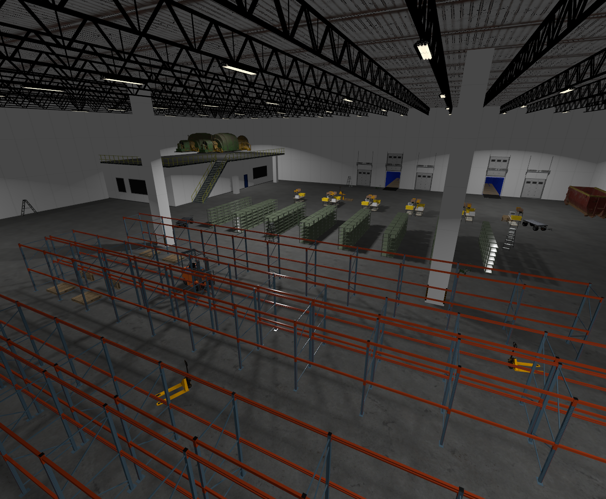

# jetty_demo
Jetty demo world and resources



## Steps to Launch

Ensure the correct Ubuntu version is used (Ubuntu 24.04)

```bash
lsb_release -a
```

Ensure Gazebo Jetty is installed, or install the Jetty binaries [here] (https://gazebosim.org/docs/latest/install_ubuntu/)

```bash
dpkg -l gz-jetty
```

Launch the demo

```bash
cd ~/vda5050_core/vda5050_gz/jetty_demo
export GZ_SIM_RESOURCE_PATH=`pwd`/models:$GZ_SIM_RESOURCE_PATH
gz sim -v 4 worlds/jetty.sdf
```

## Performance notes

It can take some time to load the world with all the models.
The GUI will be non-responsive during this time.

To speed up loading the demo world, you can comment out different models
in the world, which helps improve startup time and RTF.

For example, some `Picking_Shelves*` were already commented out in
the world sdf file. To further speed things up, you can comment out
all of them.
